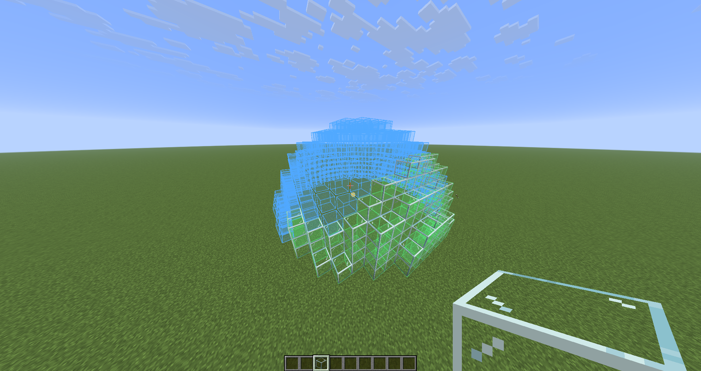

**Perfect curves, built by hand.** Ortho shows block-by-block outlines of circles, spheres, domes, arches and more right in your world, like a stencil you build along.

Everything happens on your own computer: Ortho needs nothing on the server and sends no packets.

## What it does

Aim at a block, press **G**, and the shape appears there as outlines, block by block:

- **Blue**: a block still to place.
- **Green**: a block is already there.
- **Orange**: a block in the way inside a hollow shape (for example the ground inside a sphere you want to dig out).

The colors update as you build, so you always see what is left.

## Shapes

| Flat shapes | 3D shapes |
|---|---|
| Circle | Sphere |
| Ellipse | Ellipsoid |
| Polygon (3 to 16 sides) | Cylinder |
| Parabolic arch | Cone and frustum (cut-off cone) |
| | Dome (half or quarter) |
| | Torus (donut ring) |

- **Sizes are widths in blocks**, so both odd and even sizes work: a 16-wide circle is centered between blocks, a 17-wide one on a block.
- **Hollow or filled**, with a wall thickness of 1 to 16. A 1-thick wall has no gaps you can see through.
- **Depth** turns flat shapes into walls or slabs, for example a round window or a thick arch.
- **Open or closed ends**: cylinders, cones and frustums with or without caps, domes with or without a floor, arches without a base line.
- **Orientation**: stand shapes up along the X or Z axis, and spin or tilt them in 15° steps.

## Building tools

- **Layer mode** shows one Y level at a time, so you can build a dome or sphere layer by layer without the rest in the way. The block count per layer is shown too.
- **Nudge**: hold **Left Alt** and scroll to move the layer (in layer mode) or move the shape up and down. Your hotbar does not scroll while you do this.
- **Mirror**: set a mirror plane on X or Z. Every block you place gets its mirror position outlined in purple (orange if a different block is there), and the block you aim at shows its counterpart.
- **Saved per world**: the anchor and mirror are remembered for each world and server, so you can come back to a build later.

## Controls

| Key | What it does |
|---|---|
| **G** | Place the shape at the block you aim at (or at your feet) |
| **H** | Show or hide the stencil |
| **Left Alt** + scroll | Move the layer, or the shape up and down |
| (not bound) | Open the settings screen |
| (not bound) | Turn layer mode on or off |

All keys can be changed under Options → Controls → Ortho. The settings screen also opens with `/ortho` or from [Mod Menu](https://modrinth.com/mod/modmenu).

## Commands

| Command | What it does |
|---|---|
| `/ortho` | Open the settings screen |
| `/ortho anchor [x y z]` | Place the shape at the block you aim at, or at exact coordinates |
| `/ortho shape <name>` | Pick a shape |
| `/ortho size <x> [y] [z]` | Set the width, height and length |
| `/ortho layer [y / off]` | Layer mode |
| `/ortho mirror [x / z / off] [position]` | Set the mirror plane (`120` = between blocks, `120.5` = on a block center) |
| `/ortho show` / `/ortho hide` | Show or hide the stencil |
| `/ortho info` | Shape, position, block count and building progress |
| `/ortho limit` | Show or change the size limits (see below) |
| `/ortho clearmarks` | Forget the placed blocks the mirror is tracking |

## Limits and performance

Only blocks within 48 blocks of you are drawn, nearest first, up to 4000 at a time, so even huge shapes stay smooth. Shapes are worked out in the background when you change a setting.

To stop a typo from freezing the game, shapes are limited to 256 blocks per side and 2,000,000 blocks. You can raise both with `/ortho limit size <blocks>` (up to 1024) and `/ortho limit blocks <count>`. Very large shapes use more memory and take longer to work out.

## Servers

Ortho only draws outlines on your screen: it never places blocks and sends nothing to the server, so it works on any server without being installed there. Some servers have rules against overlay or schematic mods, though, so check the rules of the server you play on.

## Compatibility

- Minecraft **26.3**, Fabric Loader 0.20.1+, [Fabric API](https://modrinth.com/mod/fabric-api), Java 25.
- Optional: [Mod Menu](https://modrinth.com/mod/modmenu) for a Configure button.
- Other Minecraft versions and NeoForge may follow.

## Credits

Made by Skaffa, written together with Claude (Anthropic). Source code on [GitHub](https://github.com/skaffa/ortho) under the [MIT License](https://github.com/skaffa/ortho/blob/main/LICENSE).
